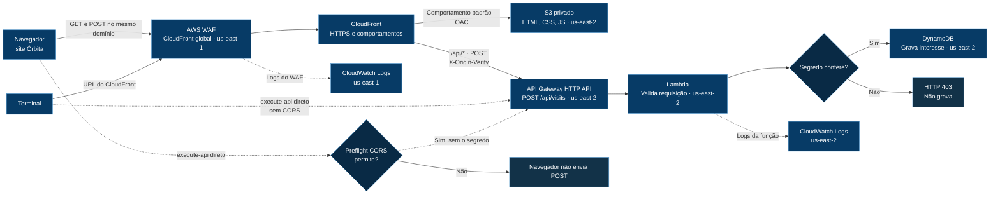

# Órbita — site em breve e arquitetura serverless na AWS

A **Órbita** é uma marca fictícia criada para um TCC: uma futura base para apresentar portfólios, projetos e processos criativos. A página de lançamento usa React, Vite e Three.js para construir um universo com planeta, órbitas e satélites. O site é entregue como arquivos estáticos; a parte dinâmica registra o interesse de quem clica no botão **Registrar interesse**. Não há cadastro de pessoas nem data de lançamento anunciada.

Este README documenta a implantação feita **manualmente pelo Console de Gerenciamento da AWS**, serviço por serviço. O repositório contém o frontend e o código de referência da Lambda; a infraestrutura foi configurada no console, sem Terraform ou CloudFormation. As telas da AWS podem mudar de nome ou posição.

## Sumário

- [Arquitetura atual](#arquitetura-atual)
- [Por que foram escolhidos serviços gerenciados](#por-que-foram-escolhidos-serviços-gerenciados)
- [Passo a passo da implantação pelo Console AWS](#passo-a-passo-da-implantação-pelo-console-aws)
- [Por que o cabeçalho personalizado e a variável da Lambda](#por-que-o-cabeçalho-personalizado-e-a-variável-da-lambda)
- [O que o frontend e a Lambda registram](#o-que-o-frontend-e-a-lambda-registram)
- [Testes de segurança feitos até aqui](#testes-de-segurança-feitos-até-aqui)
- [Executar, atualizar e verificar](#executar-atualizar-e-verificar)
- [Arquivos principais](#arquivos-principais)
- [Referências oficiais](#referências-oficiais)

## Arquitetura atual



[Abrir o diagrama SVG detalhado em tamanho completo](docs/arquitetura-orbita.svg).

**Entrega do site.** O navegador solicita `https://d1yntwcak9q8lo.cloudfront.net/`. O AWS WAF associado à distribuição inspeciona a solicitação. O CloudFront entrega o conteúdo que está em cache ou busca `index.html`, CSS, JavaScript, imagens e `config.json` no bucket privado do S3. O Origin Access Control (OAC) autoriza o CloudFront a ler os objetos sem tornar o bucket público. O certificado TLS do domínio `cloudfront.net` protege a conexão HTTPS com o visitante.

**Registro do interesse.** Ao clicar no botão, o JavaScript faz `POST /api/visits` no **mesmo domínio do site**. O comportamento `/api/*` do CloudFront escolhe a origem do API Gateway, acrescenta o cabeçalho personalizado `X-Origin-Verify` à requisição enviada à origem e não armazena a resposta em cache. O API Gateway HTTP API invoca a Lambda; ela valida o cabeçalho e o corpo e grava o item no DynamoDB. O sucesso retorna HTTP `204`, sem corpo. Abrir ou recarregar a página não registra interesse.

**Observabilidade.** A ACL do WAF envia seus registros de tráfego para um grupo do CloudWatch Logs. A Lambda também pode escrever seus logs de execução no CloudWatch Logs por meio das permissões básicas do seu perfil IAM. São fluxos de log diferentes. As métricas e amostras do WAF ajudam a ver regras acionadas; os logs completos permitem examinar uma solicitação com mais detalhe a partir do momento em que o registro foi habilitado.

| Componente | Papel nesta implantação | Região/escopo |
| --- | --- | --- |
| S3 `tcc-edn-grupo2-orbita` | Armazenar os arquivos compilados do site em bucket privado | Ohio, `us-east-2` |
| CloudFront | Entregar o site por HTTPS e encaminhar `/api/*` para a API | Global |
| AWS WAF `orbita-cloudfront-waf` | Inspecionar requisições que passam pelo CloudFront | Global para CloudFront, administrado em `us-east-1` |
| API Gateway HTTP API | Expor a rota `POST /api/visits` e invocar a Lambda | Ohio, `us-east-2` |
| Lambda `orbita-registrar-visita` | Validar a requisição e registrar o interesse | Ohio, `us-east-2` |
| DynamoDB `orbita-visits` | Guardar um item por `eventId` | Ohio, `us-east-2` |
| CloudWatch Logs | Receber os logs da ACL do WAF e, separadamente, da Lambda | Grupo do WAF em `us-east-1`; grupo da Lambda em `us-east-2` |

O domínio do CloudFront é fornecido pela AWS, por isso esta implantação não depende de Route 53 nem de domínio próprio. O **S3 usa a origem normal do bucket com OAC**: o endpoint de hospedagem de site estático do S3, mesmo que tenha sido ativado durante a configuração inicial, não é a origem usada para servir esta distribuição privada.

### Por que o WAF e os logs dele estão em `us-east-1`?

O CloudFront é um serviço **global**: o conteúdo é entregue por pontos de presença, e o usuário não escolhe Ohio como a região da distribuição. Para associar uma Web ACL do AWS WAF a uma distribuição CloudFront, a AWS exige o escopo **CloudFront (global)** e fixa a região de gerenciamento dessa ACL em **Norte da Virgínia (`us-east-1`)**. Isso é uma exigência da integração WAF–CloudFront, não uma decisão de mover o site para lá. Uma ACL **regional** em Ohio não seria a mesma proteção associada a essa distribuição. Veja a [documentação da AWS sobre a criação da Web ACL](https://docs.aws.amazon.com/waf/latest/developerguide/web-acl-creating.html).

O **CloudWatch não está inteiro em `us-east-1`**. Ele é regional. Para receber os registros dessa Web ACL global, o grupo de **CloudWatch Logs do WAF** precisa estar na **mesma região da ACL**, portanto em `us-east-1`. Já a **Lambda está em Ohio (`us-east-2`)**; seu grupo separado de logs de execução fica em Ohio. Por isso, ao consultar os registros do WAF no Console AWS, selecione **Norte da Virgínia**; para os logs da função, selecione **Ohio**. A tabela DynamoDB, a HTTP API e o bucket S3 continuam em Ohio. Veja a [exigência de região para o destino de logs do WAF](https://docs.aws.amazon.com/waf/latest/developerguide/logging-cw-logs.html).

O diagrama também mostra dois caminhos alternativos de teste: um `fetch` do navegador diretamente para `execute-api` pode provocar uma verificação CORS antes do POST; se essa verificação falhar, o navegador não envia o POST. O terminal não aplica CORS e pode chamar tanto o domínio do CloudFront quanto o `execute-api`. No acesso direto à API sem o valor esperado no cabeçalho, o API Gateway ainda invoca a Lambda, que responde `403` antes de gravar no DynamoDB.

## Por que foram escolhidos serviços gerenciados

O objetivo do TCC é demonstrar entrega de conteúdo, integração entre frontend e backend e controles de segurança sem manter um servidor ligado continuamente. Nesta solução, a AWS opera a infraestrutura subjacente de armazenamento, CDN, entrada HTTP, execução, banco e inspeção de requisições. O projeto ainda precisa configurar permissões, regras, logs, orçamento, código e atualizações.

| Necessidade | Serviço escolhido | O que seria necessário em servidores próprios ou EC2 |
| --- | --- | --- |
| Hospedar o frontend compilado | S3 privado | Manter servidor web, disco, sistema operacional e rotina de atualização. |
| Entregar arquivos com HTTPS e cache | CloudFront | Configurar proxy/CDN, certificados, cache e distribuição geográfica. |
| Receber a chamada HTTP | API Gateway HTTP API | Operar Nginx ou outro proxy, disponibilidade e roteamento da API. |
| Executar a lógica somente sob demanda | Lambda | Manter processo Node.js, máquinas, escalabilidade e deploy do serviço. |
| Persistir os eventos | DynamoDB sob demanda | Instalar e operar banco, backups, capacidade e atualizações. |
| Inspecionar e observar tráfego | AWS WAF e CloudWatch Logs | Operar regras, coleta e armazenamento de logs por conta própria. |

O frontend React **continua compilado** mesmo usando uma API dinâmica. O navegador recebe HTML, CSS e JavaScript do S3 via CloudFront; a chamada à API acontece depois, no clique. A Lambda não recompila React a cada acesso. Essa escolha reduz a manutenção operacional para uma demonstração pequena, mas não significa custo zero: WAF, CloudWatch Logs e os demais serviços podem consumir créditos e gerar cobrança conforme uso e configuração.

## Passo a passo da implantação pelo Console AWS

Os passos abaixo descrevem o que foi montado e como reproduzir a mesma arquitetura no **Console AWS**. Os nomes das opções podem aparecer em português ou inglês. Não inclua o valor do segredo, chaves de acesso nem dados da conta neste repositório.

### 1. Compilar o frontend no computador

Na pasta do projeto, com Node.js compatível com o Vite 7:

```sh
npm ci
npm run build
```

O Vite cria `dist/`. Essa pasta é o resultado pronto para hospedagem: envie **o conteúdo de `dist/`**, incluindo `index.html`, `assets/`, `config.json` e `favicon.svg`, para a **raiz** do bucket. Não envie `src/`, `node_modules/` nem o arquivo ZIP para servir o site. Os nomes dos arquivos em `assets/` podem mudar a cada compilação.

### 2. Criar e preencher o bucket S3

No **Console AWS → S3 → Criar bucket**, foi criado um bucket de propósito geral em Ohio (`us-east-2`). O acesso público foi bloqueado. Depois, em **Objetos → Carregar**, os arquivos compilados foram enviados. A política de leitura do bucket foi limitada à distribuição CloudFront com OAC, em vez de tornar os objetos públicos. Para este fluxo, a criptografia SSE-S3 padrão atende ao armazenamento dos arquivos; versionamento pode ajudar a recuperar uma publicação anterior, mas versões antigas também ocupam espaço.

### 3. Criar a distribuição CloudFront para o site

No **Console AWS → CloudFront → Criar distribuição**, foi selecionado o domínio regional normal do bucket S3 como origem, com acesso privado por **Origin Access Control**. A opção do console que permite ao CloudFront atualizar a política do bucket foi usada para autorizar a leitura pela distribuição. O **Default root object / Objeto raiz padrão** foi definido como `index.html`. O comportamento padrão aponta para o S3; o visitante usa HTTPS no domínio `cloudfront.net` fornecido pela AWS. Não foi necessário comprar domínio ou emitir um certificado ACM próprio para esse endereço.

Uma *origin* é o destino de onde o CloudFront busca conteúdo; um *behavior* é a regra que escolhe a origem e define métodos HTTP, cache e políticas para um padrão de caminho. Neste caso, o comportamento padrão atende o site no S3, e `/api/*` atende a API.

### 4. Criar a tabela DynamoDB

No **Console AWS → DynamoDB → Criar tabela**, foi criada `orbita-visits` com chave de partição `eventId` do tipo **String**, sem chave de classificação, e capacidade **sob demanda**. A Lambda calcula `expiresAt` como um horário Unix aproximadamente 30 dias após o registro. **Esse atributo sozinho não apaga itens**: se a exclusão automática for desejada, é necessário habilitar o TTL da tabela usando exatamente o atributo `expiresAt`. A remoção pelo TTL é assíncrona.

### 5. Criar a função Lambda e sua permissão

No **Console AWS → Lambda → Criar função**, foi criada `orbita-registrar-visita` com runtime Node.js. O código de referência está em [`backend/lambda.mjs`](backend/lambda.mjs). Ao colá-lo no editor `index.mjs` da função no console, o handler permanece `index.handler`. Os runtimes Node.js atuais da Lambda incluem uma versão do AWS SDK para JavaScript v3, utilizada pelo editor do console. Para controlar a versão das dependências em um pacote próprio, a pasta `backend/` contém o manifesto para instalá-las e incluí-las no envio.

No perfil de execução IAM da Lambda, além das permissões básicas para logs, foi adicionada uma política de menor privilégio que permite `dynamodb:PutItem` **somente** na tabela `orbita-visits`. Em **Configuração → Variáveis de ambiente**, foram definidos `VISITS_TABLE` com o nome da tabela e `ORIGIN_VERIFY_SECRET` com o valor privado acordado com a origem do CloudFront. O valor do segredo **não** fica no React, no `config.json`, no README ou no Git. Depois de alterar o código ou as variáveis, é preciso implantar a função no console.

### 6. Criar a HTTP API no API Gateway

No **Console AWS → API Gateway**, foi criada uma **HTTP API regional** com a rota `POST /api/visits`, integração com a Lambda e formato de evento da integração Lambda proxy 2.0. O estágio `$default` está com implantação automática. O endereço regional `execute-api` continua existindo; o CloudFront não o torna privado. A permissão para o API Gateway invocar a Lambda deve estar presente na política de recurso da função, geralmente criada durante a integração pelo console.

### 7. Associar a API ao CloudFront

Em **CloudFront → distribuição → Origins / Origens**, foi adicionada uma segunda origem com o **nome de domínio** da HTTP API, sem `https://` e sem caminho. A ligação com a origem usa HTTPS. Nessa origem, foi configurado o cabeçalho personalizado `X-Origin-Verify`, cujo valor privado é o mesmo configurado em `ORIGIN_VERIFY_SECRET` na Lambda. O campo *Origin path* fica vazio para o estágio `$default`.

Em **Behaviors / Comportamentos**, foi criado o padrão `/api/*`, apontando para a origem do API Gateway. Os métodos permitidos incluem `POST`; a política de cache é `CachingDisabled`, e a política de encaminhamento de origem usada é `AllViewerExceptHostHeader`. O cabeçalho `Host` do domínio CloudFront não deve substituir o host esperado pela API. Essa política também inclui cabeçalhos de localização gerados pelo CloudFront; a Lambda aproveita `CloudFront-Viewer-Country`, `CloudFront-Viewer-Country-Region` e `CloudFront-Viewer-Time-Zone` quando chegam. Se algum valor faltar, o código usa `unknown` ou `UTC`.

O frontend usa `/api/visits`, e não a URL `execute-api`, porque o navegador já está no domínio do CloudFront. Isso mantém a chamada na mesma origem do site e evita a necessidade de CORS para esse fluxo. CORS controla o acesso a respostas entre origens **no navegador**; não impede `curl` ou outro cliente de chamar uma URL. A proteção contra gravação direta está na validação feita pela Lambda.

### 8. Associar o WAF ao CloudFront

No **Console AWS → WAF e Shield / CloudFront → Security**, foi criado o pacote de proteção (Web ACL) `orbita-cloudfront-waf`, com escopo **CloudFront (global)**, e associada a distribuição. O grupo gerenciado **AWS Managed Rules — Core rule set** foi adicionado. Para observar o comportamento antes de bloquear tráfego legítimo, as regras começaram em **Count / Contar**. Depois do teste, a ação de `CrossSiteScripting_QUERYARGUMENTS` foi alterada para **Block / Bloquear**. As demais regras devem ser conferidas individualmente antes de mudar de Count para Block.

Essa ACL fica **na entrada do CloudFront**, antes da escolha da origem. Portanto, inspeciona tanto pedidos do site no S3 quanto pedidos `/api/*` que passem pela distribuição. Ela **não inspeciona** chamadas feitas diretamente ao endereço `execute-api` da HTTP API.

### 9. Habilitar os logs do WAF no CloudWatch

No **WAF → `orbita-cloudfront-waf` → Configurar registro e solicitações em amostra**, foi habilitado **Registro em log → Destino do registro em log → Amazon CloudWatch Logs**. O grupo de logs do WAF usa o prefixo obrigatório `aws-waf-logs-`. Como a ACL protege CloudFront, seu escopo global é administrado em **Norte da Virgínia (`us-east-1`)**; é nessa região que se consulta o grupo de logs do WAF, mesmo com S3, API, Lambda e DynamoDB em Ohio (`us-east-2`). No CloudWatch, abra **Logs → Gerenciamento de logs → Grupos de logs**, selecione `us-east-1` e procure o grupo `aws-waf-logs-*` escolhido no console.

As **solicitações em amostra** e as métricas já eram úteis sem o registro completo, mas mostram apenas uma parte do tráfego e não necessariamente todos os campos de uma ocorrência. Os logs completos começam a ser enviados **a partir da habilitação**; não recuperam solicitações passadas. Inspeção de logs e consultas podem gerar custo, então acompanhe o painel de faturamento e a retenção do grupo. Também considere censurar campos sensíveis se vierem a ser usados no site.

## Por que o cabeçalho personalizado e a variável da Lambda

O endereço público da HTTP API pode ser chamado sem passar pelo CloudFront. Como o WAF está associado somente à distribuição, uma chamada direta também não passa por suas regras. Para que uma chamada direta **sem o valor esperado** não grave um item no DynamoDB, o CloudFront acrescenta o cabeçalho `X-Origin-Verify` **na comunicação com a origem API Gateway**. O navegador não recebe nem precisa conhecer esse valor. O API Gateway encaminha a requisição à Lambda, que compara o cabeçalho recebido com `ORIGIN_VERIFY_SECRET` e responde `403` antes da gravação se ele estiver ausente ou incorreto. A variável de ambiente mantém o valor fora do código publicado no S3 e permite alterá-lo sem modificar o frontend.

**Limite importante:** isso não torna a HTTP API privada nem prova que a requisição veio de um navegador. Uma chamada direta sem o cabeçalho **ainda chega ao API Gateway e invoca a Lambda**; o que é negado é o registro no DynamoDB. Quem obtiver o valor poderá enviá-lo diretamente ao `execute-api`, e um terminal também pode chamar o domínio do CloudFront como qualquer outro cliente. Portanto, a afirmação correta é: **sem conhecer o valor, a chamada direta não passa pela validação da Lambda**. Esse controle não elimina custos de tentativas diretas nem substitui autenticação de usuários, limites de requisições e proteção específica da API. O valor deve permanecer privado e ser atualizado de forma coordenada no CloudFront e na Lambda se houver suspeita de exposição.

## O que o frontend e a Lambda registram

O arquivo [`src/analytics.js`](src/analytics.js) lê [`public/config.json`](public/config.json) e envia o POST **somente no clique**. O corpo contém um `eventId` UUID v4 e `source`. O `source` usa `utm_source` da URL quando válido; caso contrário, pode usar o domínio do referenciador ou `direct`. Esses campos enviados pelo navegador são entradas não confiáveis e não servem para autorizar a requisição.

A Lambda grava `eventId`, `source`, `country`, `region`, `visitedAt` em UTC, `visitedAtLocal`, `timeZone` e `expiresAt`. País, região e fuso dependem dos cabeçalhos recebidos da origem CloudFront; podem ficar `unknown` ou `UTC`. **O código atual não grava `eventType`, endereço IP ou dados de cadastro.** Outros serviços da AWS podem manter logs técnicos próprios, inclusive endereços IP.

O navegador guarda `orbita-interest-event-id` e `orbita-interest-confirmed` em `localStorage` para manter o botão como **Registrado** após recarregar e reduzir reenvios. Se uma tentativa falhar, o mesmo `eventId` pode ser reutilizado; a escrita condicional da Lambda evita uma segunda linha para esse ID. Isso não identifica uma pessoa entre navegadores ou após limpar os dados locais.

## Testes de segurança feitos até aqui

Os testes foram feitos **na própria distribuição do projeto**, sem modificar o frontend para executar conteúdo recebido na URL. Um padrão detectado pelo WAF não significa que uma vulnerabilidade tenha sido explorada.

| Teste | Observação no projeto | O que demonstra |
| --- | --- | --- |
| String parecida com XSS em parâmetro de URL, por exemplo `?teste=%3Cscript%3Ealert%281%29%3C%2Fscript%3E` | Com a regra em **Count**, o WAF contou a correspondência e a página abriu. Depois de colocar `CrossSiteScripting_QUERYARGUMENTS` em **Block**, uma solicitação de teste recebeu **403** do CloudFront. | A regra pode reconhecer e bloquear essa assinatura na query string. Não prova que o site tivesse XSS refletido: a página não interpretou o parâmetro como HTML. |
| String de travessia de caminho/LFI em `arquivo`, como `?arquivo=..%2F..%2Fconfig.json` | A métrica `GenericLFI_QUERYARGUMENTS` apareceu em **Count**. | O WAF reconheceu um padrão de tentativa; não houve leitura de arquivo pelo aplicativo. Acessar `/config.json` como objeto público do site é diferente de explorar LFI. |
| Correspondência `CrossSiteScripting_COOKIE` | Surgiu em métricas **Count** durante navegação, inclusive em pedidos de arquivos estáticos. Não foi enviado um cookie de ataque intencional nesse teste. | É preciso examinar uma ocorrência nos logs do WAF para saber qual campo foi considerado suspeito. A métrica sozinha não identifica o cookie nem comprova um ataque. |
| POST direto ao endereço `execute-api` sem o cabeçalho esperado | A Lambda responde **403** e não grava o item. | Validação do valor antes da escrita. A chamada ainda alcança o API Gateway e invoca a função. |
| POST pelo domínio CloudFront após clicar no botão | A resposta esperada é **204**, com um novo item na tabela; o botão passa a **Registrado**. | Integração do caminho `/api/*` com API Gateway, Lambda e DynamoDB. O status e o item devem ser verificados juntos. |

Para investigar um evento novo, procure a requisição pelo horário, URI, ação e regra em **WAF → ACL → painel/solicitações em amostra**; se a amostra não trouxer detalhes suficientes, use o grupo `aws-waf-logs-*` no **CloudWatch Logs em `us-east-1`**. Uma resposta 403, isoladamente, não identifica qual regra a produziu: confirme a ação no log.

## Executar, atualizar e verificar

```sh
npm ci
npm run dev
npm run build
npm run preview
```

`npm run dev` serve para desenvolvimento local. `npm run build` gera os arquivos estáticos em `dist/`; `npm run preview` permite inspecionar localmente essa compilação. Para publicar uma nova versão, carregue novamente **o conteúdo** de `dist/` na raiz do bucket S3. Se arquivos antigos com nomes diferentes permanecerem no bucket, eles não fazem parte do novo `index.html`, mas podem continuar ocupando espaço. Quando for preciso atualizar objetos que ainda podem estar no cache, crie uma **invalidação** no CloudFront para os caminhos afetados, como `/`, `/index.html` ou `/config.json`. Uma invalidação nova não exige apagar as anteriores; elas são registros de operações já feitas.

No navegador, abra **DevTools → Network**: antes do clique, não deve haver `POST /api/visits`; após o clique, confira o `204` e o item no DynamoDB. Recarregue a página para verificar que o botão permanece confirmado no mesmo navegador. Confira também o CloudFront/WAF: uma solicitação bloqueada pela regra de XSS deve aparecer como **Block**, enquanto regras em Count apenas contabilizam. Caso a API falhe, o site estático continua abrindo e o botão permite nova tentativa.

## Arquivos principais

```text
src/main.jsx              interface React e botão de interesse
src/Universe.jsx          cena espacial com Three.js
src/style.css             estilos
src/analytics.js          envio do interesse e persistência local
public/config.json        configuração pública do endpoint relativo
backend/lambda.mjs        código de referência da função Lambda
backend/package.json      dependências do backend
docs/arquitetura-orbita.svg  diagrama da implantação
```

`dist/` e `node_modules/` são gerados localmente e ignorados pelo Git. O valor do cabeçalho privado não deve ser incluído no repositório, no pacote do frontend ou em capturas públicas do Console AWS.

## Referências oficiais

- [Vite: implantação de site estático](https://vite.dev/guide/static-deploy)
- [CloudFront: restringir acesso ao S3 com OAC](https://docs.aws.amazon.com/AmazonCloudFront/latest/DeveloperGuide/private-content-restricting-access-to-s3.html)
- [CloudFront: adicionar cabeçalhos personalizados às origens](https://docs.aws.amazon.com/AmazonCloudFront/latest/DeveloperGuide/add-origin-custom-headers.html)
- [CloudFront: política gerenciada AllViewerExceptHostHeader](https://docs.aws.amazon.com/AmazonCloudFront/latest/DeveloperGuide/using-managed-origin-request-policies.html)
- [Lambda Node.js: versão do AWS SDK incluída no runtime](https://docs.aws.amazon.com/lambda/latest/dg/lambda-nodejs.html)
- [AWS WAF: criar uma Web ACL para CloudFront](https://docs.aws.amazon.com/waf/latest/developerguide/web-acl-creating.html)
- [AWS WAF: enviar logs ao CloudWatch Logs](https://docs.aws.amazon.com/waf/latest/developerguide/logging-cw-logs.html)
- [AWS WAF: ações Count e Block](https://docs.aws.amazon.com/waf/latest/APIReference/API_RuleAction.html)
